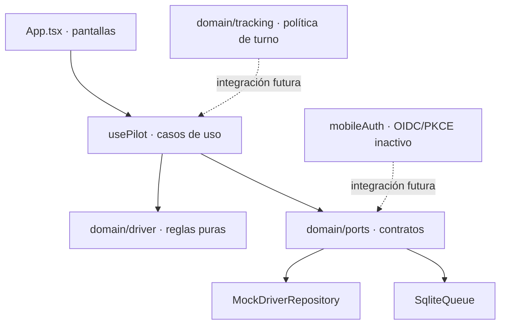

# Arquitectura del piloto móvil

## Referencias examinadas

- `KANTRACK-ROADMAP-IMPLEMENTACION.md`, en especial KT-007-04/05 y KT-012-02/03.
- `KANTRACK-ESPECIFICACION-MAESTRA.md`, en especial las superficies CONNECT, §8.12, §11.13 y §15.11.
- `KanTrackFinal-Hexagonal/contracts/openapi/connect.yaml` y módulos `logistics`, `tracking`, `identity` del backend.

La especificación sitúa React Native + Expo en KT-012-03, después del CONNECT PWA. Exige PKCE en navegador de sistema, almacenamiento seguro, viajes/paradas/POD, cola offline, ubicación solo en turno, push y SOS. Actualmente el OpenAPI CONNECT no define esos endpoints y el backend de logística no sirve aún las operaciones móviles. Por eso el piloto usa un repositorio de datos ficticios.

## Capas

La UI solo solicita acciones. El dominio valida las transiciones; el caso de uso persiste cada acción antes de reflejarla en pantalla. El repositorio de viajes y la cola se inyectarán por interfaces cuando exista API; hoy `usePilot` construye las implementaciones de demostración. La cola separa acciones por tenant/conductor y conserva su identificador. `replay` reconstruye estado y marca conflictos de acciones que ya no aplican.

## Seguridad y privacidad

- Los datos de ejemplo son ficticios y el modo demo se señala en toda la app.
- PKCE y tokens se aíslan en `mobileAuth.ts`; no se llama a ese módulo hasta que existan issuer, client ID, redirect URI, scopes y validación de audiencia acordados.
- La política `mayTrack` exige un turno validado por backend y expiración acotada. Este piloto no solicita ubicación ni define tareas de rastreo.
- El botón SOS guarda un evento local después de dos segundos; el aviso comunica que no genera asistencia real.
- Antes de integrar producción se requiere cifrar o minimizar la cola, copiar POD a almacenamiento privado durable, controlar tamaño/retención, permitir cierre de sesión y limpieza por identidad, y probar aislamiento entre tenants.

## Flujo de sincronización previsto

Una integración futura deberá obtener una sesión móvil válida, descargar viajes con versión/ETag, enviar acciones con clave de idempotencia, resolver 409 y 401 de forma explícita y confirmar la persistencia remota antes de retirarlas de la cola. SOS tendría prioridad, pero requiere confirmación del servidor y un canal de emergencia operativo. Las URL, rutas y payloads quedan por definir en el contrato OpenAPI; no se inventan aquí.
